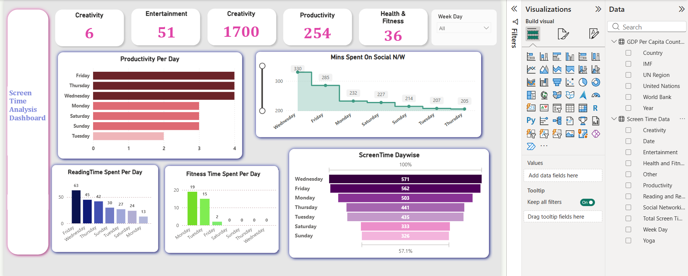

## 📸 Dashboard Preview


# 📱 Screen Time Analytics Dashboard | Power BI

An interactive data analytics project built using Microsoft Power BI to explore screen time usage patterns and understand digital habits through data visualization.

---

## 📌 Project Overview

The **Screen Time Analytics Dashboard** is a data visualization project designed to analyze screen time data and present meaningful information through an interactive Power BI report.

The project focuses on transforming spreadsheet data into visual insights that make screen time patterns easier to understand. It demonstrates the use of data preparation, dashboard design, and business intelligence techniques to explore digital usage.

## 🎯 Project Objectives

- Analyze screen time usage patterns.
- Explore app usage and digital activity using the available dataset.
- Identify trends and comparisons in screen time data.
- Present key information through charts, graphs, and summary metrics.
- Build a clear and user-friendly Power BI dashboard.
- Improve data analysis and visualization skills.

## ❓ Problem Statement

Digital devices are an important part of everyday life, but understanding screen time habits can be difficult when usage information is presented only in spreadsheet form.

This project uses Power BI to organize and visualize screen time data, making it easier to explore questions such as:

- How much screen time is recorded in the dataset?
- Which apps or categories account for the most usage?
- What patterns can be identified in digital activity?
- How can data visualization help people understand their screen time habits?

## 🛠️ Tech Stack

| Tool | Purpose |
|---|---|
| Microsoft Power BI | Dashboard development and data visualization |
| Microsoft Excel | Dataset storage and data preparation |
| Power Query | Data cleaning and transformation, where applicable |
| DAX | Calculated measures, where applicable |
| GitHub | Project storage and documentation |

## 📂 Project Structure

```text
Screen-Time-Dashboard/
│
├── Screen Time Dashboard.pbix
├── screentime data.xlsx
├── dashboard.png
└── README.md
```

## 📊 Dataset

The project uses the Excel dataset `screentime data.xlsx` as its data source.

The dataset is used to explore screen time information and related digital usage patterns.

The analysis and visualizations depend on the columns and records available in the dataset.

## 📈 Dashboard Features

The dashboard is designed to present screen time information in a visual and easy-to-understand format.

### Key Components

- **KPI Summary:** Displays important screen time metrics, where configured.
- **Usage Analysis:** Helps explore screen time distribution.
- **App Analysis:** Supports comparisons between apps, if app-level data is available.
- **Data Visualization:** Presents information through charts and graphs.
- **Interactive Analysis:** Allows users to explore the data using available filters and slicers.

## 🖼️ Dashboard Preview


## 💡 Key Analysis Areas

The project supports exploration of the following questions:

- Which app or category has the highest recorded usage?
- How is screen time distributed across the available records?
- Which usage patterns stand out in the visualizations?
- What can the data reveal about digital activity?

*Note: Specific findings should be added after checking the actual dashboard results.*

## 🚀 How to Run

### 1. Download the Repository

Download or clone this GitHub repository to your computer.

### 2. Open the Power BI File

Open `Screen Time Dashboard.pbix` using Microsoft Power BI Desktop.

### 3. Connect the Dataset

If Power BI requests the data source, select `screentime data.xlsx` from the project folder.

### 4. Refresh the Data

Refresh the dataset if required and resolve any data source prompts.

### 5. Explore the Dashboard

View the charts, summary metrics, and available interactive filters to explore screen time patterns.

## 🎓 Skills Demonstrated

`Power BI` `Data Analysis` `Data Visualization` `Dashboard Design` `Excel` `Power Query` `DAX` `GitHub`

## 📝 Project Summary

The Screen Time Analytics Dashboard demonstrates how Microsoft Power BI can be used to transform spreadsheet data into an organized visual report. The project provides practical experience in data analysis, visualization, and dashboard development while making screen time information easier to explore.

---

**Author:** Aswathib18

**GitHub Profile:** [Aswathib18](https://github.com/Aswathib18)
